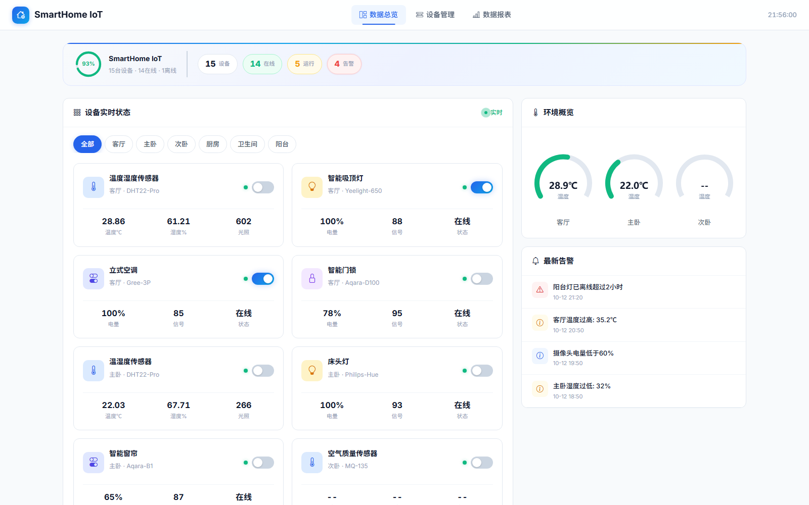
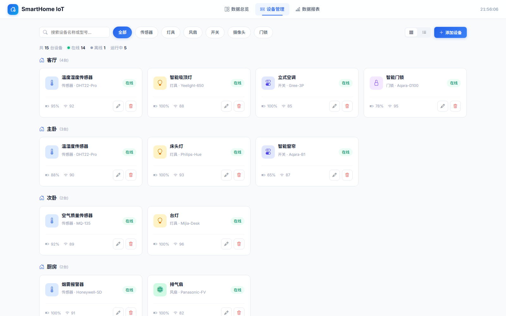

# SmartHome IoT - 智能家居数据管理系统

一个 **Spring Boot 3 + MyBatis + MySQL** 的智能家居数据管理系统：设备实时状态、房间分组、环境监测、
告警中心与数据报表，前端由后端直接托管，双击脚本即可运行。

## 效果预览

> 以下截图均为项目真实运行时的界面（数据来自 `sql/init.sql` 内置的演示数据集）。

**数据总览** —— 设备统计、房间筛选、环境仪表与告警列表



**设备管理** —— 按房间分组、类型筛选、搜索与在线状态



**数据报表** —— ECharts 绘制的温度 / 湿度 / 光照 / CO₂ 趋势


## 技术栈

| 层级 | 技术 |
|------|------|
| 后端 | Java 21 · Spring Boot 3.5 · MyBatis 3 · Lombok |
| 数据库 | MySQL 8（库名 `smart_home_iot`，5 张表） |
| 前端 | 原生 H5 + CSS · ECharts 5 · Bootstrap Icons |
| 构建 | Maven Wrapper（无需预装 Maven） |

---

## 朋友电脑需要安装

| 软件 | 必须 | 下载地址 |
|---|---|---|
| **JDK 17+** | ✅ | https://adoptium.net/ |
| **MySQL 8.0** | ✅ | https://dev.mysql.com/downloads/mysql/ |
| Chrome浏览器 | ✅ | 系统自带或自行安装 |

> **不需要安装**: Maven、IDEA、Node.js、Python
>
> 若本机 Java 不在 PATH，请设置环境变量 `JAVA_HOME` 指向 JDK 目录（例如 `D:\java`）。

---

## 快速启动（3步）

### 第1步：安装MySQL
1. 下载安装MySQL 8.0
2. 记住你的 root 密码（稍后启动脚本会提示输入）

### 第2步：配置数据库
1. 打开命令提示符（Win+R 输入 cmd）
2. 进入项目目录的 `sql` 文件夹
3. 执行（可重复执行，会重置演示数据）：
```bash
mysql -u root -p < init.sql
```

### 第3步：启动项目
1. 双击 `一键启动.bat`
2. 等待约20秒
3. 浏览器自动打开 http://localhost:8080

启动后可访问：

- 数据总览: http://localhost:8080
- 设备管理: http://localhost:8080/pages/management.html
- 数据报表: http://localhost:8080/pages/report.html

---

## 手动启动（如果一键启动失败）

```bash
# 1. 设置数据库密码（application.yml 通过环境变量读取，仓库中不含明文密码）
set DB_PASSWORD=你的MySQL密码

# 2. 进入后端目录
cd backend

# 3. 启动Spring Boot（首次会自动下载Maven）
mvnw.cmd spring-boot:run

# 4. 打开浏览器访问
# http://localhost:8080
```

---

## 项目结构

```
SmartHomeIoT/
├── backend/          # SpringBoot后端（同时托管前端静态页）
├── frontend/         # H5前端页面
├── sql/              # 数据库脚本（支持重复执行）
└── 一键启动.bat      # 启动脚本
```

---

## 常见问题

**Q: 端口8080被占用怎么办？**
A: 设置环境变量 `SMARTHOME_PORT` 指定其它端口（`set SMARTHOME_PORT=9090`），或改 `application.yml` 的 `port: ${SMARTHOME_PORT:8080}` 默认值

**Q: MySQL密码不是默认值怎么办？**
A: 设置环境变量 `DB_PASSWORD` 即可（`set DB_PASSWORD=你的密码`），启动脚本也会提示输入。
   后备方案：在 `application.yml` 中把 `password: ${DB_PASSWORD:}` 改为明文密码（并注意不要提交到仓库）

**Q: Java版本不对怎么办？**
A: 需要JDK 17或更高版本，推荐JDK 21。设置 `JAVA_HOME` 后重新运行启动脚本

**Q: 打开 http://localhost:8080 是空白/404？**
A: 确认后端已启动成功（窗口内出现 `Started SmartHomeApplication`）。前端已由后端托管，无需再单独打开 html 文件

**Q: 想重新灌入演示数据？**
A: 再次执行 `sql/init.sql` 即可（会清空并重置房间/设备/传感器/告警/规则）
